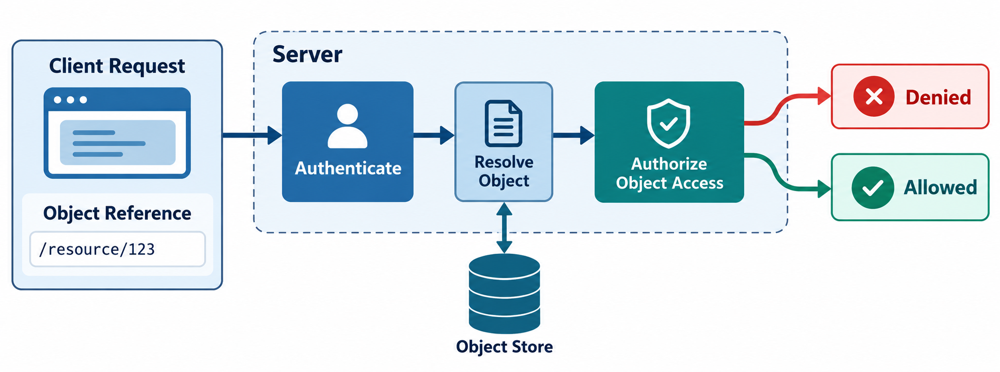

# 2. Technical Foundations and Root Causes

An HTTP request carries a method, target, headers, cookies or bearer token, and possibly a body. The server should derive the principal from the verified session, parse the requested object reference, evaluate policy for the action and object, and only then query or mutate the data.

```text
request → authenticate principal → resolve object → authorize action/object → query or mutate → response
```



The important boundary is the authorization decision. Authentication identifies the caller, but the object check determines whether that caller may act on the specific record.

Cookies and JWTs establish identity and claims; they do not prove ownership of an arbitrary object. REST paths, query parameters, JSON fields, GraphQL variables, download tokens, and background-job IDs can all carry references.

```python
# Vulnerable: parameterization prevents injection, not IDOR.
invoice = db.execute("SELECT * FROM invoices WHERE id = ?", (invoice_id,)).fetchone()

# Secure shape: ownership/tenant scope is part of the lookup.
invoice = db.execute(
    "SELECT * FROM invoices WHERE id = ? AND tenant_id = ?",
    (invoice_id, current_user.tenant_id),
).fetchone()
if invoice is None:
    abort(404)
```

The second query enforces the boundary at the data-access operation. Root causes include authorization implemented only in the UI, hidden fields treated as trusted, controller-specific checks that drift across API versions, unrestricted `findById` repositories, missing tenant predicates, and middleware that checks endpoint access but not object ownership. Static files and asynchronous exports are often missed because they use different handlers.
