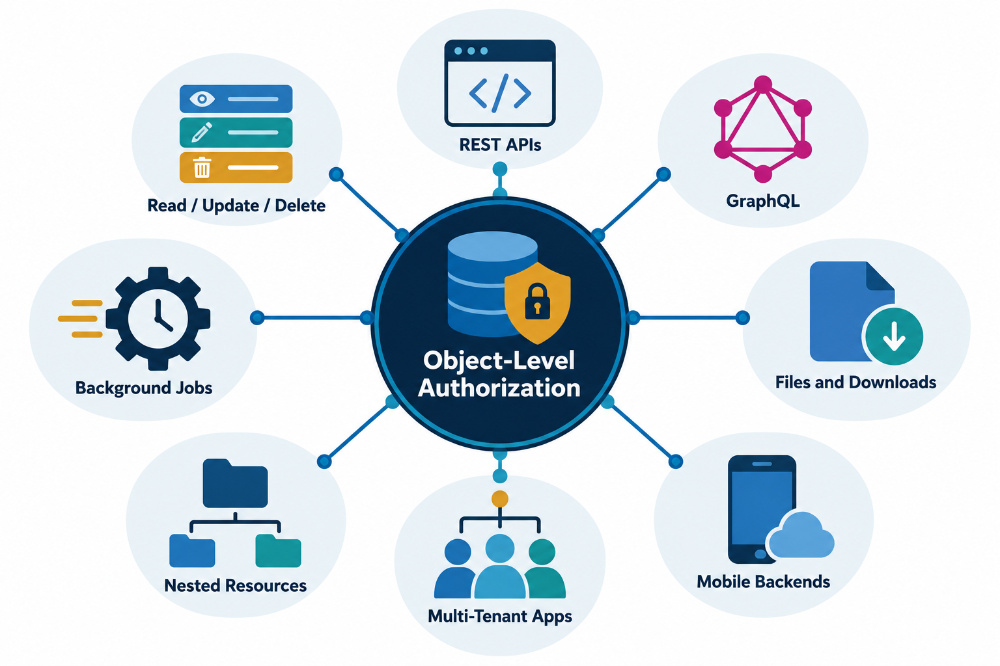

# 3. Types and Attack Surfaces

IDOR can appear in many forms. Categories can overlap: one issue may be both horizontal and read-based, or both a REST and multi-tenant IDOR. The key question is which authorization decision was missing and what action became possible.

## Section files

1. [Horizontal and vertical IDOR](3.1-horizontal-and-vertical-idor.md)
2. [Read, update, and delete IDOR](3.2-read-update-delete-idor.md)
3. [REST API IDOR](3.3-rest-api-idor.md)
4. [GraphQL IDOR](3.4-graphql-idor.md)
5. [Files and document access](3.5-files-and-document-access.md)
6. [Nested and indirect references](3.6-nested-and-indirect-references.md)
7. [Multi-tenant applications](3.7-multi-tenant-idor.md)
8. [Mobile application backends](3.8-mobile-application-backends.md)
9. [Background jobs and exports](3.9-background-jobs-and-exports.md)

These files describe authorized assessment surfaces, not standalone exploitation labs.

