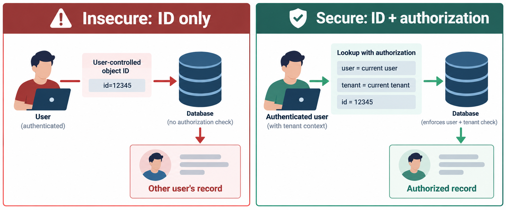

# 7. Remediation and Secure Coding

Enforce authorization on the server for every object action, using the authenticated principal, requested object, action, and tenant/role policy. Prefer deny-by-default and least privilege. Centralize policy decisions or constrain repository methods so new controllers cannot silently bypass them.



```python
def get_invoice(invoice_id, user):
    invoice = Invoice.query.filter_by(id=invoice_id, tenant_id=user.tenant_id).first_or_404()
    if not policy.may_view_invoice(user, invoice):
        abort(404)
    return invoice
```

The predicate is necessary but application-specific: delegated access, support roles, legal holds, and object state may require additional policy. For updates and deletes, authorize immediately before mutation and test that denied requests leave state unchanged.

Use RBAC for stable role permissions and ABAC when decisions depend on tenant, ownership, classification, relationship, or state. Protect file and export handlers with the same policy as record endpoints. Log authorization denials and sensitive grants without secrets or unnecessary personal data.

Ineffective fixes include hiding IDs in the UI, checking only that a user is logged in, comparing a client-supplied `user_id`, relying solely on UUIDs, or fixing one route while leaving downloads and bulk endpoints open.

```python
def test_other_tenant_cannot_read(client, bob, invoice_a):
    response = client.get(f"/invoices/{invoice_a.id}", headers=bob.auth)
    assert response.status_code in (403, 404)
```
